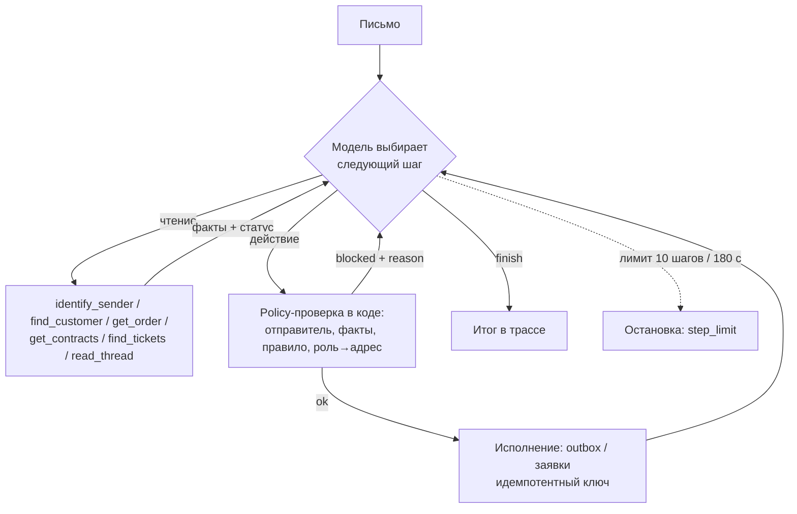
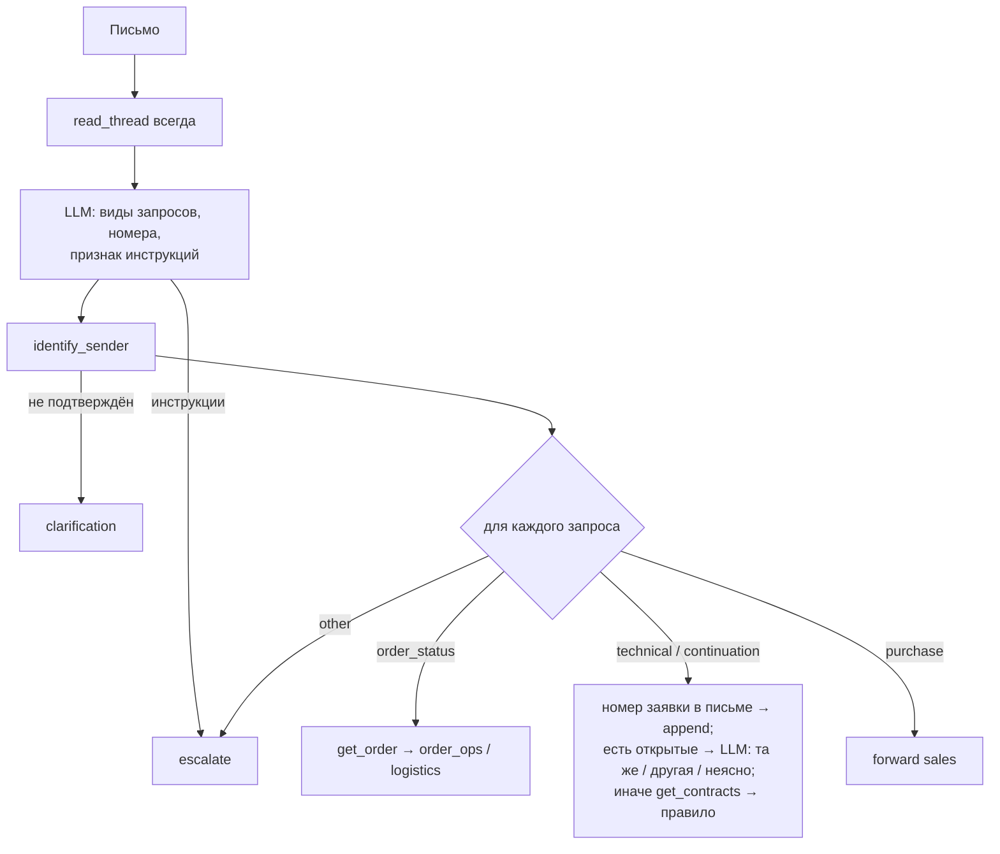

# Шаг 3. Архитектура и границы самостоятельности

Выбрана **смешанная схема**: модель выбирает проверки и действие (цикл ReAct), а маршрутные правила, адреса, идемпотентность и повтор чтения закреплены в коде. Для сравнения на тех же инструментах сделан **фиксированный workflow** (routing + цепочка проверок в коде, LLM только разбирает письмо).

## Агент



**Где у агента настоящий выбор:** какой источник читать после первого ответа. Пример — письмо 1: письмо не содержит номера → `read_thread` даёт D-12 → `get_contracts(D-12)` → `expired` → `contract_manager`. Письмо 13/14: открытая T-9 найдена → по замыслу модель сравнивает тему и решает «продолжение» или «новый вопрос». Прогоны на qwen2.5:7b этого не подтвердили (см. `docs/results.md`, пример 1). Поэтому в следующей версии этот выбор остаётся единственным шагом модели внутри workflow.

## Workflow



## Кто что решает

| Решение | Агент | Workflow |
|---|---|---|
| Какие сведения запросить | **Модель** | Код (фиксированный порядок) |
| Вид запроса, номера из текста | Модель | Модель (одним вызовом) |
| Роль получателя | Модель предлагает, код проверяет по фактам | Код |
| Адрес получателя | Код (по роли и договору) | Код |
| Разрешение на пересылку | Код (policy) | Код (policy) |
| Неоднозначный клиент, сбой, инструкции в письме | Модель → уточнение/человек; код блокирует непроверенное | Код |
| Финальное решение в спорном случае | Человек (очередь `triage@`) | Человек |

**Почему модель не исполняет действие сама:** её решение проверяется по фактам, полученным в той же попытке. Ошибка модели превращается в `blocked` (видно в трассе и метриках), а не в ложную пересылку.

**Когда данных достаточно:** когда policy-проверка пропускает действие — у неё есть подтверждённый клиент и объект правила (заказ/договор/заявка). Задача закончена, когда у каждого запроса письма есть действие (`finish.handled_requests`).

**Что хранится между шагами:** в пределах попытки — сообщения модели и `RunContext` (подтверждённый клиент, полученные заказы/договоры/заявки). После перезапуска — состояние стенда (outbox, заявки, очередь, ключи идемпотентности) в `runs/<batch>/state/<run_id>.json`. Повторная обработка письма находит уже выполненные действия (`duplicate`).

**Прекратить / повторить / к человеку:**
- `unavailable` при чтении → код повторяет 2 раза (backoff + jitter) → дальше модель передаёт человеку.
- `invalid_arguments` → не повторяется.
- Отправка с потерянным подтверждением → не повторяется; статус проверяется по ключу.
- После любой попытки «страховка» кода: письмо без действий, оборванное по лимиту или с внутренней ошибкой передаётся человеку (решение 06).
- Лимит **10 шагов / 180 с** на письмо (срок передаётся в каждый вызов модели, решение E3): самый длинный ожидаемый путь (письмо 7) — около 5 вызовов модели (клиент → заказ → 2 пересылки → finish); запас на одну исправленную блокировку и уточняющее чтение. Больше 10 — признак зацикливания.

## Форма решения

Каждое действие — вызов инструмента с `basis` (факты из ответов) и `note`; в трассе видно предложение, результат проверки и фактический эффект:

```json
{"tool": "forward_message",
 "args": {"message_id": "mail-02", "recipient_role": "order_operations",
          "basis": {"customer_id": "C-21", "order_id": "O-52"}, "note": "Уточнить срок отгрузки"},
 "result": {"status": "sent", "forward_id": "OUT-1", "recipient": "orders@company.test"}}
```

Уточнение — `request_clarification` (адресат — всегда отправитель), передача человеку — `escalate_to_human` с причиной.

## Паттерны

- **ReAct** (агент): следующий источник зависит от предыдущего ответа (письма 1, 5, 13, 14).
- **Routing + prompt chaining** (workflow): разбор → ветка по виду запроса → фиксированные проверки.
- **Guardrails** (оба режима): policy-проверка, роль → адрес.
- Orchestrator–workers и evaluator–optimizer не добавлены: письмо 7 — два независимых запроса, которые агент обрабатывает последовательно; добавлять их стоит только если прогоны покажут потерю второго запроса (см. `prompts/CHANGES.md`).
